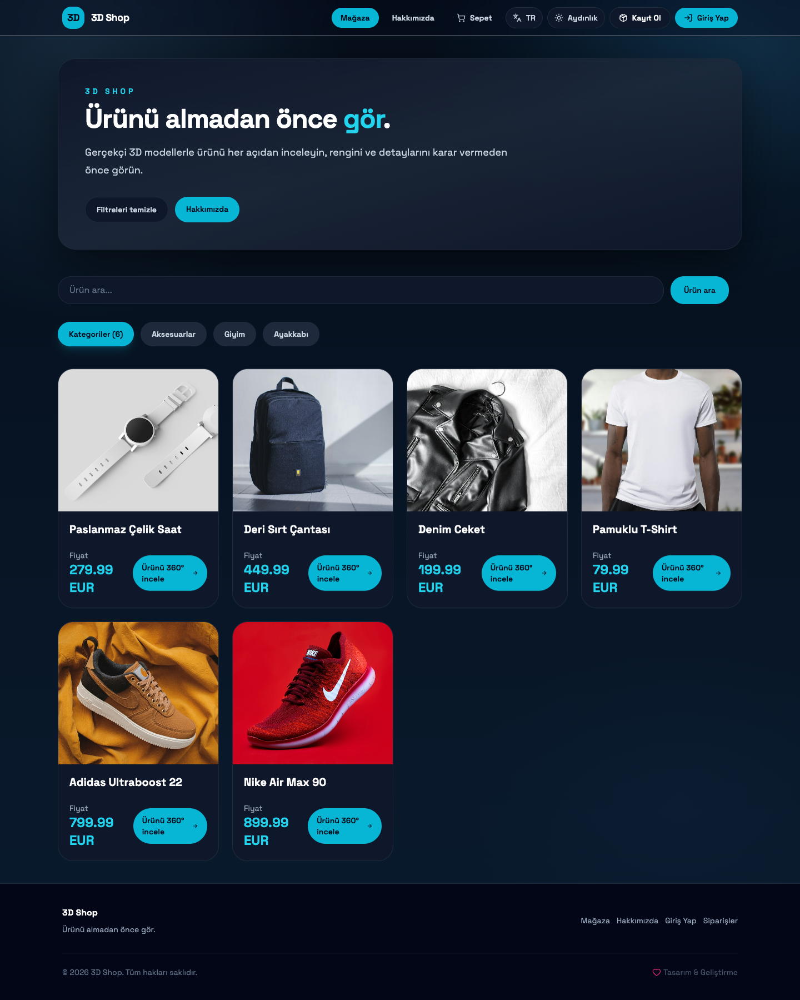
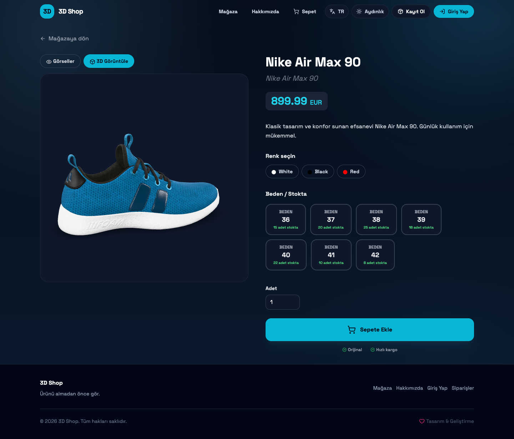
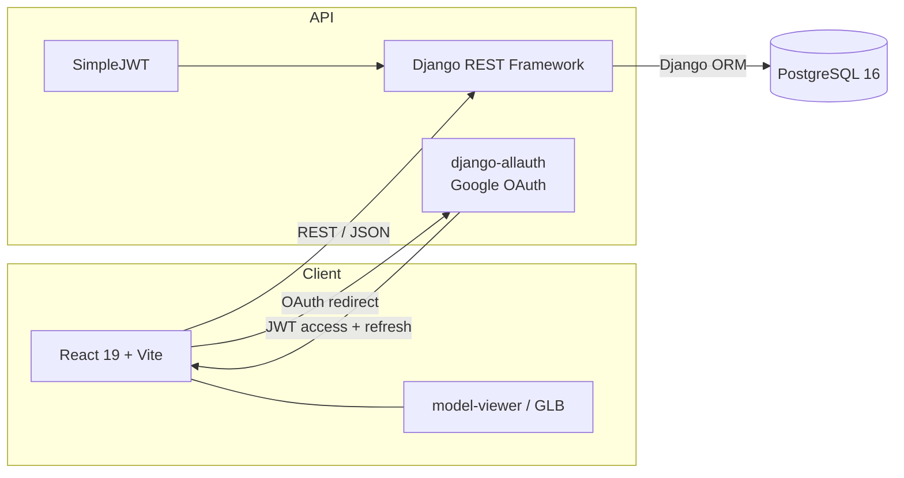
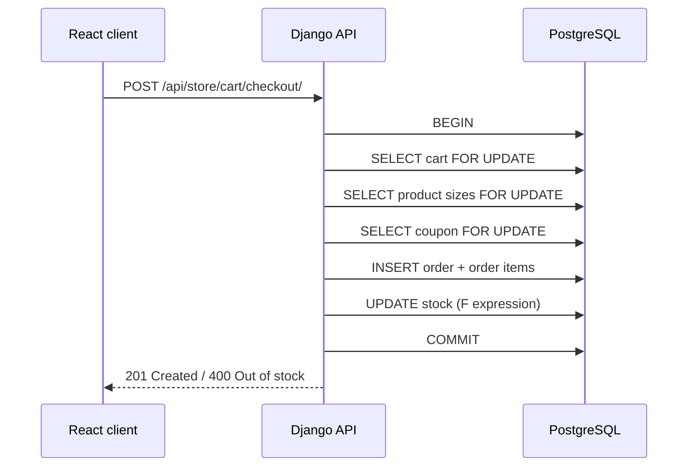

# 3D Store

**“Ürünü almadan önce gör.” — See it before you buy.**

A full-stack e-commerce demo where shoppers can inspect a product in 3D before adding it to the cart. Built with React, Django REST Framework and PostgreSQL, with JWT authentication, Google OAuth, coupons and concurrency-safe stock handling.

[](https://github.com/Cnek00/4Project/actions/workflows/ci.yml)


## Screenshots

| Storefront | 3D product preview |
| --- | --- |
|  |  |

The interface is available in **Turkish, English and German**. The screenshots show the Turkish storefront; switch the language from the navbar.

## Highlights

- **3D product previews** with `<model-viewer>`: rotate, zoom and inspect a GLB model before buying.
- **Server-side cart** with stock validation on every add/update.
- **Coupon engine**: percentage or fixed discounts, validity window and usage limits.
- **Checkout with PostgreSQL row locks**: `select_for_update()` prevents two customers from buying the same last item, and locks the coupon row so a usage limit cannot be exceeded by concurrent requests.
- **JWT authentication** (access + refresh) and **Google OAuth** via django-allauth.
- **i18n** for Turkish, English and German.
- **32 backend tests** covering cart, coupons, checkout snapshots and concurrent stock locking.
- **CI** that runs Django tests against PostgreSQL, Python lint, React lint and a production build.

## Architecture



Checkout uses a short transaction with row-level locks:



## Tech stack

| Layer | Technology |
| --- | --- |
| Frontend | React 19, Vite 7, React Router 7, Axios, Tailwind CSS 3, Framer Motion, i18next, `@google/model-viewer` |
| Backend | Django 6, Django REST Framework, SimpleJWT, dj-rest-auth, django-allauth |
| Database | PostgreSQL 16 (SQLite only as a local demo fallback) |
| Tooling | Ruff, ESLint, GitHub Actions, Gunicorn, WhiteNoise, Render blueprint |

## Repository layout

```
.
├── .github/workflows/ci.yml       # tests + lint + build
├── docs/
│   ├── planning/                  # product/API/architecture notes from the build phase
│   └── screenshots/               # README screenshots
├── render.yaml                    # one-click Render blueprint (API + static site + Postgres)
└── 3D Web Project/
    ├── backend/                   # Django project
    │   ├── core/                  # settings, URLs, OAuth adapter
    │   ├── store/                 # products, cart, coupons, orders, tests
    │   ├── users/                 # custom email-based user model
    │   ├── fixtures/              # six demo products
    │   └── media/                 # demo thumbnails + GLB model
    └── frontend/                  # React SPA
        ├── public/locales/        # tr / en / de translations
        └── src/
```

## Getting started

### Prerequisites

- Python **3.12+**
- Node.js **20+**
- PostgreSQL **16** — or set `USE_SQLITE=True` for a quick local demo
- Docker (optional, for the PostgreSQL container)

### 1. Backend

```bash
cd "3D Web Project/backend"
cp .env.example .env          # edit the values
python3 -m venv .venv
source .venv/bin/activate
pip install -r requirements.txt
```

For a quick demo without PostgreSQL, set `USE_SQLITE=True` in `.env`. For the real setup, create a database and fill in `DB_NAME`, `DB_USER`, `DB_PASSWORD`, `DB_HOST` and `DB_PORT`.

```bash
python manage.py migrate
python manage.py load_products_from_json   # 6 demo products, images and the GLB shoe
python manage.py createsuperuser           # optional, for /admin
python manage.py runserver
```

The API is now at `http://127.0.0.1:8000/` and the admin at `http://127.0.0.1:8000/admin/`.

To create the demo products from scratch, `load_products_from_json --clear` removes the existing catalogue first.

### 2. Frontend

```bash
cd "3D Web Project/frontend"
cp .env.example .env
npm install
npm run dev
```

Open `http://127.0.0.1:5173/`. The API URL is controlled by `VITE_API_URL` (default `http://127.0.0.1:8000`).

### Environment variables

| Variable | Purpose | Example |
| --- | --- | --- |
| `SECRET_KEY` | Django signing key | long random string |
| `DEBUG` | Debug mode | `False` in production |
| `ALLOWED_HOSTS` | Comma-separated hostnames | `localhost,127.0.0.1` |
| `DB_NAME`, `DB_USER`, `DB_PASSWORD`, `DB_HOST`, `DB_PORT` | PostgreSQL connection | see `.env.example` |
| `USE_SQLITE` | Local SQLite fallback | `False` |
| `GOOGLE_CLIENT_ID`, `GOOGLE_CLIENT_SECRET` | Google OAuth credentials | from Google Cloud Console |
| `CORS_ALLOWED_ORIGINS` | Allowed frontend origins | `http://localhost:5173` |
| `CSRF_TRUSTED_ORIGINS` | Trusted HTTPS origins in production | `https://your-frontend.example` |
| `VITE_API_URL` | API origin consumed by the SPA | `https://your-api.example` |

> Never commit `.env`. The repository only contains `.env.example` files.

## Tests

```bash
cd "3D Web Project/backend"
python manage.py test store users --verbosity 2
```

Coverage includes:

- **Cart** — adding items, accumulating quantity, stock checks, quantity updates and removal.
- **Coupons** — percentage/fixed discounts, expiry, usage limits, invalid codes and “never below zero” totals.
- **Checkout** — order creation, price snapshots, stock decrement, coupon usage and rejected checkouts.
- **Concurrent stock locking** — two customers race for the last item; exactly one order succeeds. This test requires PostgreSQL and is skipped automatically when `USE_SQLITE=True`.
- **Catalogue** — filtering, search, visibility and product detail.

Run the same checks as CI:

```bash
ruff check .
cd ../frontend
npm run lint
npm run build
```

## CI

`.github/workflows/ci.yml` runs on every push and pull request:

- Django tests against a PostgreSQL 16 service (including the row-lock concurrency test)
- Ruff lint for Python
- ESLint and a Vite production build for the frontend

## Deployment

The repository includes a [`render.yaml`](render.yaml) blueprint that provisions:

1. a PostgreSQL database,
2. a Gunicorn/Django web service,
3. a static site for the React build.

**To deploy:**

1. Push the repository to GitHub.
2. In Render, choose **New → Blueprint** and select this repository.
3. Set `GOOGLE_CLIENT_ID` and `GOOGLE_CLIENT_SECRET` when prompted (or leave OAuth disabled).
4. After the first deploy, add the final URLs to `CORS_ALLOWED_ORIGINS`, `CSRF_TRUSTED_ORIGINS` and `VITE_API_URL`, then redeploy.

The backend also ships with a `Dockerfile` and runs `migrate` + `collectstatic` on start, so it can be deployed to any container platform.

## API

The main endpoints are documented in [docs/planning/API_REFERENCE.md](docs/planning/API_REFERENCE.md). Quick reference:

| Method | Endpoint | Description |
| --- | --- | --- |
| `GET` | `/api/store/products/` | Product list (search, category filter, pagination) |
| `GET` | `/api/store/products/<id>/` | Product detail + 3D model URL |
| `POST` | `/api/token/` | Obtain JWT access/refresh token |
| `POST` | `/api/store/cart/add_to_cart/` | Add a product/size/colour |
| `POST` | `/api/store/cart/apply_coupon/` | Apply a coupon |
| `POST` | `/api/store/cart/checkout/` | Create an order with stock locking |
| `GET` | `/api/store/orders/` | Current user's orders |

## Documentation

- [Planning and API notes](docs/planning/) — original product/architecture notes from the build phase.
- [API reference](docs/planning/API_REFERENCE.md)
- [Frontend implementation guide](docs/planning/FRONTEND_IMPLEMENTATION_GUIDE.md)

## Credits

- 3D shoe model: [Khronos glTF Sample Assets — Materials Variants Shoe](https://github.com/KhronosGroup/glTF-Sample-Assets/tree/main/Models/MaterialsVariantsShoe), © Shopify, [CC BY 4.0](https://creativecommons.org/licenses/by/4.0/).
- Demo product photos: [Unsplash](https://unsplash.com/) (free-to-use licence).
- Icons: [Lucide](https://lucide.dev/).

---

Built by [Cenk](https://github.com/Cnek00) as a portfolio project.
